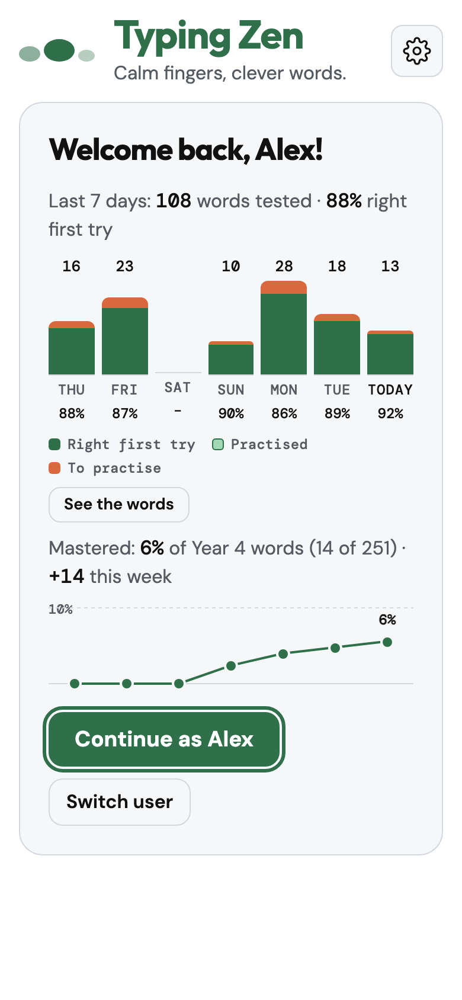
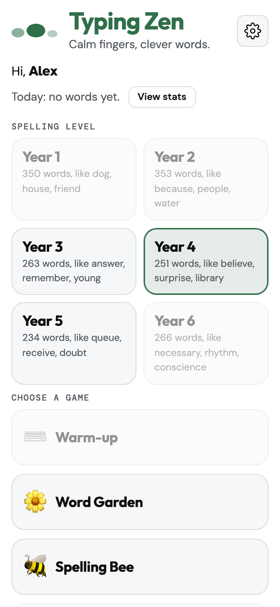
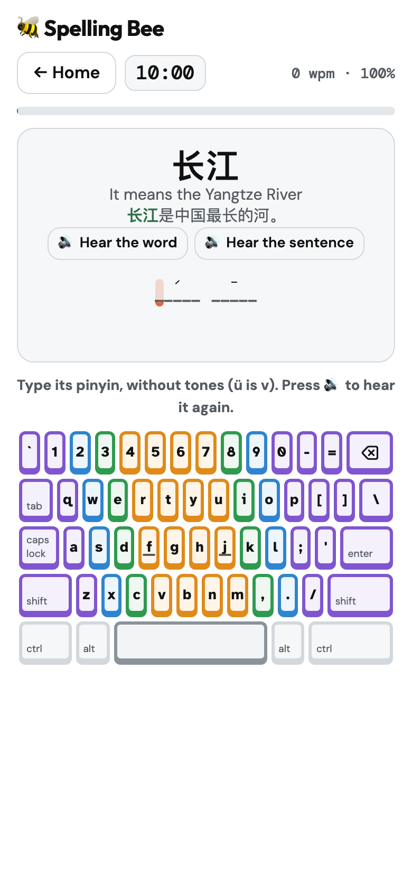

# ⌨️ Typing Zen

**A calm touch-typing and spelling app for primary-school children, Year 1 to Year 6.**
Practise touch typing while learning to spell, in English, Danish (Dansk) or Chinese (中文, typed as pinyin).
No ads, no tracking. Works offline once added to your home screen.

### ▶ [Open the app](https://trix69.github.io/typing-zen/)

<p align="center">
  
  
  
</p>

## What it does

**Spelling Bee**
- A timed round (10 or 20 minutes). Each word is spoken, then read in a sentence; the child types it from memory.
- Words missed come back later, words spelled right first try three times in a row count as mastered, and recently learned words are favoured a little.
- One slip fixed before the hint counts as right first try. Two misses on the same letter show it in orange.
- A short fanfare at the end, different for one, two or three stars.

**Practice and Word Garden**
- Practice: the day's missed words, typed five times each with no mistakes. The word is said, then spelled out.
- Word Garden: learn new words with their meaning before meeting them in the Spelling Bee.

**Progress**
- The last 7 days as a chart: right first try, practised, still to practise. Tap "See the words" for the lists.
- Mastered words per year, with a 7-day line.
- Optional ranking board for children signed in with Google: names are masked (Lu******h), and only the number of words tested in the last 7 days is shared.

**Languages**
- **English**: 1,714 words in UK spelling, sorted into Year 1 to Year 6 by the National Curriculum spelling lists, each with a meaning and an example sentence.
- **Dansk**: about 1,700 Danish words for 0. to 5. klasse, on a Danish keyboard layout, with the whole interface in Danish.
- **中文**: 1,511 words for Year 1 to Year 6, each with an example sentence. The word is shown in characters and typed as pinyin without tones on an English keyboard (ü is typed v). The tone marks show above the letters as a hint.
- Each language keeps its own history: switching language never loses progress.

**And also**
- An on-screen keyboard coloured by finger, highlighting the next key; or the device's own keyboard on phones.
- Five mechanical key sounds to choose from (recordings from [kbsim](https://github.com/tplai/kbsim)).
- Several children per device, each with their own year and progress. Sign in with Google to keep progress in step across devices; or just type a name to keep it on this device only.
- Light and dark appearance, an update check that asks before installing, and offline use from the home screen.

## Privacy

Typing Zen signs a child in with Google only if you choose to, so their progress can follow them between devices; everything else stays on the device. No advertising, no analytics, no trackers. The app asks for the [privacy policy](https://trix69.github.io/typing-zen/docs/privacy.html) to be accepted before it is used, and Settings has **Delete my data from Google**.

## Running it yourself

It is a static site with no build step: serve the folder and open it.

```
python3 -m http.server 8800
```

Then open http://localhost:8800/. Google sign-in needs a Firebase project of your own (`FIREBASE` in `app.js`); without it the app works with typed names only.

## Project layout

| Path | What it is |
|---|---|
| `index.html`, `style.css`, `app.js` | The page, its styles and all the logic |
| `data.js` | Interface text in Danish and the warm-up drills |
| `words.js`, `words-da.js`, `words-zh.js` | The word lists, **generated** from `wordlist/` (don't edit by hand) |
| `wordlist/` | The word list sources and the scripts that build them |
| `sw.js`, `manifest.webmanifest`, `icons/` | Offline copy and home-screen app (`sw.js` is written by `tools/make_sw.py`) |
| `fonts/`, `sounds/` | Self-hosted fonts and key-sound recordings, with their licences |
| `docs/privacy.html` | The privacy policy (English and Danish); its date is `PP_DATE` in `tools/version.py` (`python3 tools/version.py pp`) |
| `tests/` | Browser tests ([tests/README.md](tests/README.md)) |
| `tools/` | Versioning, offline copy, single-file bundle, test-site deploy, Firestore rules |

## Changing the word lists

- **English:** edit `wordlist/meanings.txt` and `wordlist/years.txt`, then `python3 wordlist/build_words.py`.
- **Dansk:** edit `wordlist/da/Y1.txt`–`Y6.txt`, then `python3 wordlist/build_words_da.py` (macOS: it also runs the Danish spell checker).
- **中文:** edit `wordlist/zh/Y1.txt`–`Y6.txt` (`characters|pinyin with tones|meaning`) and `wordlist/zh/sentences/Y1.txt`–`Y6.txt`, then `python3 wordlist/build_words_zh.py`. It checks every syllable and compares each reading with macOS's own Mandarin-to-pinyin conversion; readings that differ on purpose are listed in `wordlist/zh/allow.txt`.

Each script checks its list and fails with a message if something is wrong.

## Tests

```
tests/run.sh            # against a local server on 127.0.0.1:8801
tests/run.sh live       # against the live site
```

Playwright is needed (`NODE_PATH` pointing at its `node_modules`). See [tests/README.md](tests/README.md) for what each suite covers.

## Credits

- Fonts: [Outfit](https://fonts.google.com/specimen/Outfit), [DM Sans and DM Mono](https://fonts.google.com/specimen/DM+Sans) and [Atkinson Hyperlegible](https://brailleinstitute.org/freefont), under the SIL Open Font License (`fonts/OFL.txt`, `fonts/OFL-atkinson-hyperlegible.txt`).
- Key sounds: recordings from [kbsim](https://github.com/tplai/kbsim) by Thomas Lai, MIT licence (`sounds/LICENSE-kbsim.md`, `sounds/SOURCE.md`).

## Support

If Typing Zen helps your family, you can [buy me a coffee](https://buymeacoffee.com/trinks). ☕
